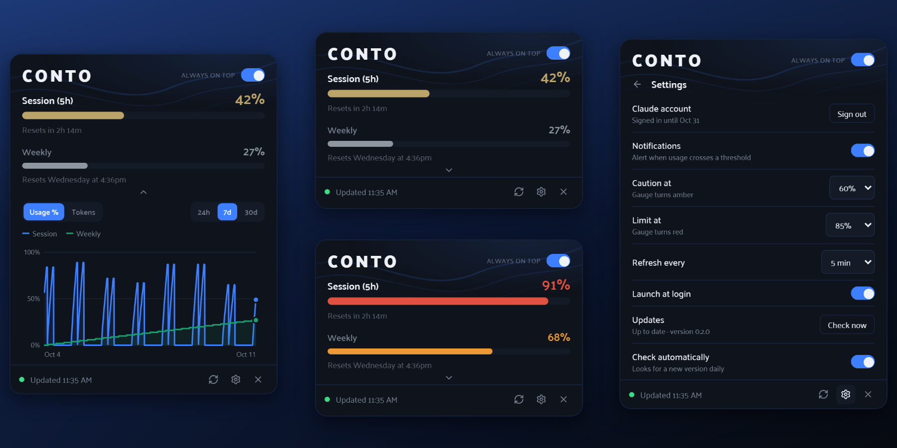
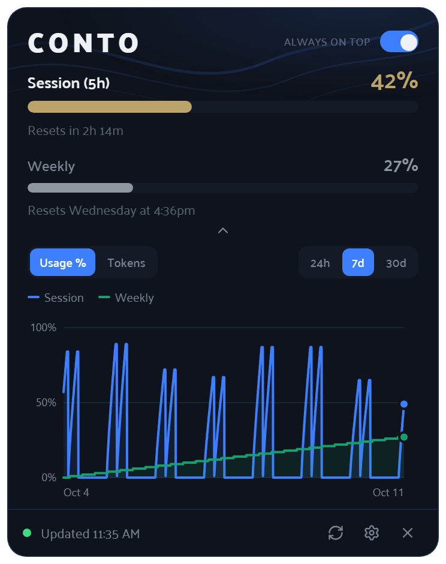
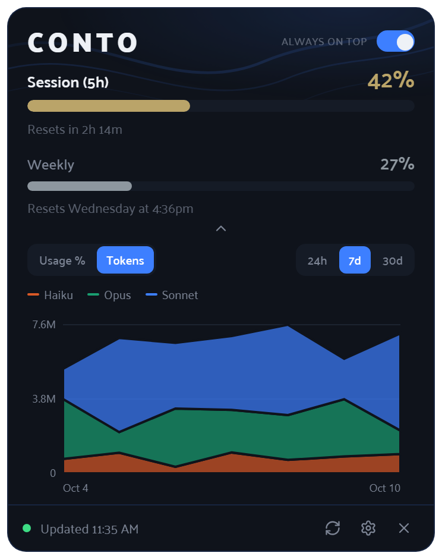
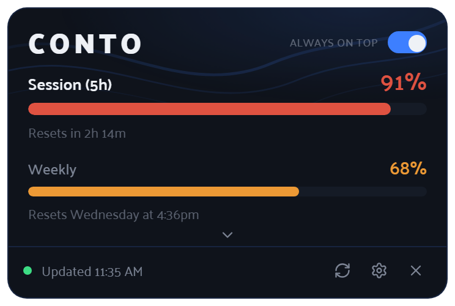
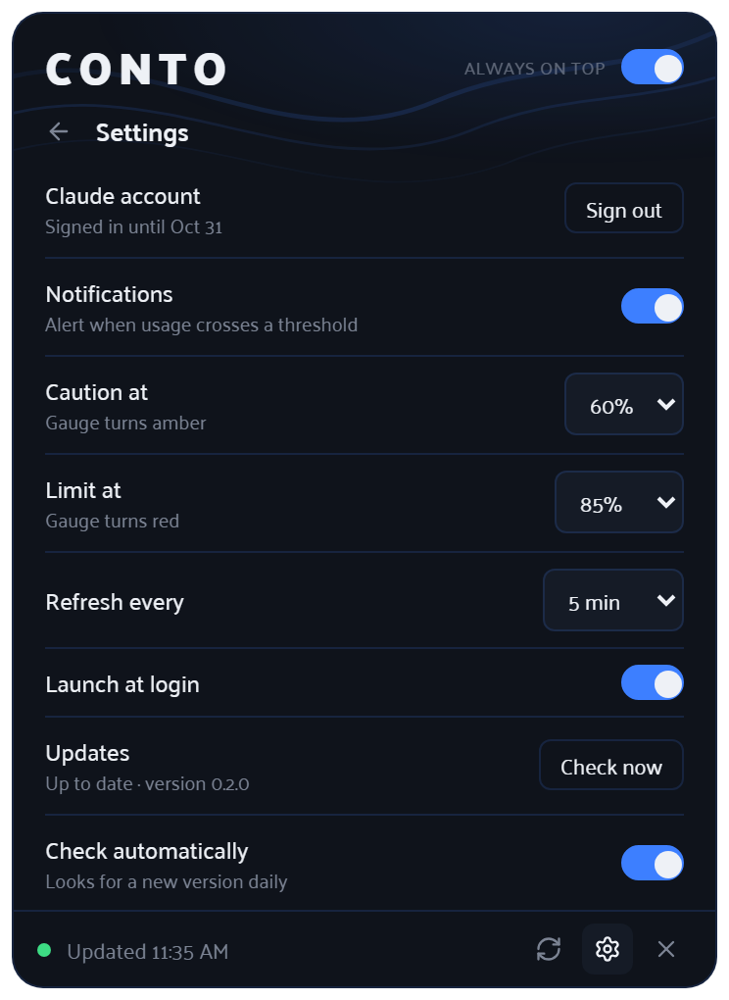
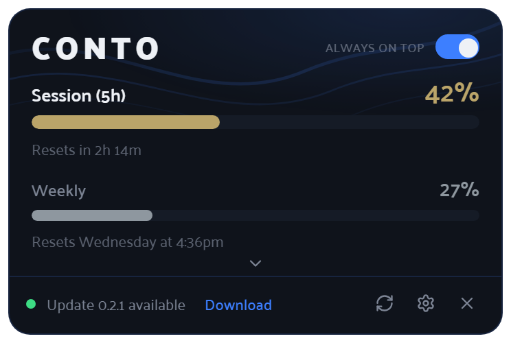
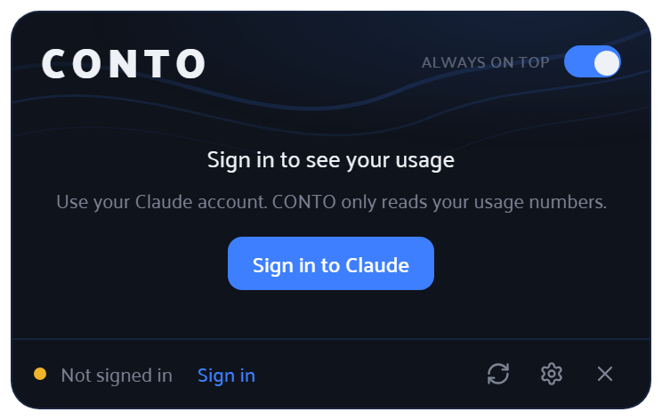

<div align="center">


# CONTO

**Your Claude usage, always one glance away.**

A tiny, good-looking desktop widget that shows your Claude 5-hour session and weekly limits,
charts your history, and nudges you before you hit the wall.

[](https://github.com/SteveAnthonyFM/conto/releases/latest)
[](https://github.com/SteveAnthonyFM/conto/actions/workflows/ci.yml)
[](LICENSE)


[**Download**](https://github.com/SteveAnthonyFM/conto/releases/latest) ·
[Features](#features) ·
[Sign-in & privacy](#signing-in--privacy) ·
[Build from source](#build-from-source) ·
[Roadmap](ROADMAP.md)

<br />



<sub>Screenshots use sample data.</sub>

</div>

<br />

## Why CONTO?

If you use Claude a lot, you've probably wondered *"how much do I have left before the reset?"*
CONTO answers that without opening a browser tab: it sits in a corner of your screen (or in your
tray / menu bar) and keeps the two numbers that matter up to date.

- **Small** — a ~370 px card that stays out of your way, and remembers where you put it.
- **Calm** — gauges change color as you approach your own thresholds, so you notice *before* you're cut off.
- **Read-only** — it only reads your usage numbers. It never writes to your account.

> CONTO is an independent hobby project, not affiliated with or endorsed by Anthropic.

## Features

| | |
|---|---|
| **Session & Weekly gauges** | Your 5-hour session and weekly limit with live percentages and reset times. Gauges go amber, then red, at thresholds you choose. |
| **History chart** | See usage % over the last 24 hours, 7 days or 30 days — or switch to **tokens by model**, built from your local Claude Code logs. |
| **Notifications** | A desktop alert when a gauge crosses your caution or limit level (and a heads-up before your sign-in expires). |
| **Tray / menu-bar icon** | Shows your session % at a glance, with minimize-to-tray and launch-at-login. |
| **Update alerts** | CONTO checks GitHub for a newer version and shows **Update available** in the footer (plus a one-time notification). Settings has a **Check now** button and a switch to turn it off. |
| **Always on top** | Pin it over your work, or let it live quietly in the tray. Position and width are remembered. |

<table>
  <tr>
    <td align="center" width="50%">
      <br />
      <sub><b>Usage history</b> — session and weekly % over time</sub>
    </td>
    <td align="center" width="50%">
      <br />
      <sub><b>Tokens by model</b> — from your local Claude Code logs</sub>
    </td>
  </tr>
  <tr>
    <td align="center">
      <br />
      <sub><b>Thresholds</b> — gauges warn you as you approach a limit</sub>
    </td>
    <td align="center">
      <br />
      <sub><b>Settings</b> — thresholds, refresh interval, notifications, updates</sub>
    </td>
  </tr>
  <tr>
    <td align="center" colspan="2">
      <br />
      <sub><b>Update alerts</b> — the footer tells you when a new version is out</sub>
    </td>
  </tr>
</table>

## Install

Download the installer for your system from the
[**latest release**](https://github.com/SteveAnthonyFM/conto/releases/latest).

Builds are **unsigned** for now, so your OS will warn you the first time:

- **macOS** — open the `.dmg`, drag CONTO to Applications, then **right-click → Open** the first time and confirm.
- **Windows** — run the installer; if SmartScreen appears, choose **More info → Run anyway**.

### Updating

CONTO tells you when a newer version is out: the footer shows **Update x.y.z available** with a
**Download** button, and you get one desktop notification per version. **Download** opens the
release page; install it over your current copy (your settings and history are kept). Nothing is
installed automatically.

You can also check any time from Settings → **Updates → Check now**, or turn the daily check off
with **Check automatically**. (Update checks only ask GitHub for the latest public release —
nothing about you is sent.)

## Signing in & privacy

On first launch CONTO shows **Sign in to Claude**:

<p align="center">
  
</p>

A normal claude.ai login window opens; sign in the way you usually do. CONTO then reads your
usage from claude.ai.

- CONTO stores **nothing** itself: the session lives in the app's own web-view cookie store (like a
  browser profile) and lasts several weeks. When it expires CONTO says so and keeps showing your
  last reading until you sign in again.
- Your session is only ever sent to `claude.ai`. It is never logged.
- Settings → **Sign out** removes it. To renew a sign-in that is about to expire, just choose **Sign in** again — a fresh login window opens and the "Signed in until" date moves out.
- If you use Claude Code, CONTO can fall back to its login when you're not signed in on the web.

> **Heads-up:** claude.ai's usage endpoint is unofficial and can change without notice. If CONTO
> stops updating after a Claude update, that's the likely cause — please
> [open an issue](https://github.com/SteveAnthonyFM/conto/issues/new/choose).

## Build from source

Requires Node 22+, Rust (stable) and the [Tauri prerequisites](https://tauri.app/start/prerequisites/).

```bash
npm install
npm run desktop          # run in development
npx tauri build          # produce an installer for your OS
```

Releases are built by GitHub Actions when a tag like `v0.2.0` is pushed
([`release.yml`](.github/workflows/release.yml)); the result is a draft release to review before publishing.

## Contributing

Bug reports and Windows testing are especially welcome — see [CONTRIBUTING.md](CONTRIBUTING.md).
Ideas for what's next live in the [roadmap](ROADMAP.md); changes are tracked in the
[changelog](CHANGELOG.md). Design notes are in [PLAN.md](PLAN.md).

## Status

Developed on macOS and tested on Windows 11 (installer, sign-in, tray, launch at login).
Windows builds are produced by CI; more testing across machines is welcome.

## License

[MIT](LICENSE) — Copyright © 2026 Palace Multimedia LLC.
Created by Steve Palazzo Jr, Palace Multimedia LLC.
